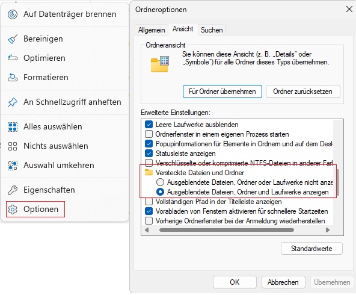

# SVWS-Tools beim SVWS-Server unter Linux

## Einbinden der SVWS-Tools Conference, Gradehub, Import, Laufbahnplanung und Prognos

## Automatische Installation

 [Download der Batch-Datei](https://github.com/TheoRichter/SVWS-Tools/raw/refs/heads/main/downloads/SVWS-Tools-Installieren.sh)  

Die Datei **SVWS-Tools-Installieren.sh** entpacken und als root mit bash SVWS-Tools-Installieren.sh ausführen. 

## Installations-Anleitung Schritt für Schritt 

### 1. Schritte

---

### Hinweis: 

Es kann sein das ProgrammData nicht angezeigt wird!

---

In der Date **svwsconfig.json** im Pfad: C:\ProgrammData\SVWS-Server\res\ folgendes Eintragen:

**"AppsPath" : "C:\\ProgramData\\SVWS-Server/tools",**

### 2. Schritte

[Download der Datei **tools.zip** und diese in dem Verzeichniss **"C:\ProgramData\SVWS-Server"** entpacken.](https://github.com/TheoRichter/SVWS-Tools/raw/refs/heads/main/downloads/tools.zip)

(wenn der SVWS-Server unter C: installiert ist !?!)

### 3. Schritte

Den Dienst SVWS-Java-Service neu Starten.

### 4. Schritte

Im Browser https://localhost/app/start eingeben und es müsste das erscheinen.

