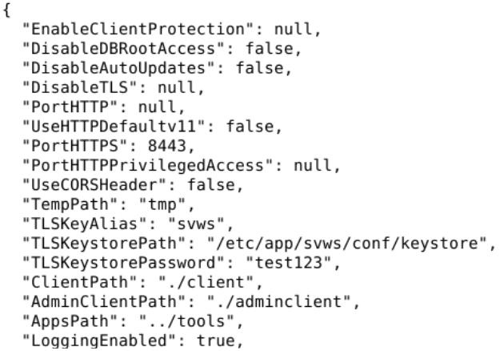

# SVWS-Tools beim SVWS-Server unter Linux

## Einbinden der SVWS-Tools Conference, Gradehub, Import, Laufbahnplanung und Prognos

## Automatische Installation

 [Download von **install-tools.zip**](https://github.com/TheoRichter/SVWS-Tools/raw/refs/heads/main/downloads/install-tools.zip)  

Die Datei **install-tools.zip** entpacken und als root mit *bash install-tools.sh* ausführen. 

```bash
unzip install-tools.zip
rm install-tools.zip
bash install-tools.sh
```

## Installations-Anleitung Schritt für Schritt 

### 1. Schritte

In der Datei **svwsconfig.json** im Pfad: /etc/app/svws/conf/ folgendes Eintragen:

**"AppsPath" : "./tools",**



### 2. Schritte

[Download der Datei **tools.zip** und diese in dem Verzeichniss **"/opt/app/svws/"** entpacken.](https://github.com/TheoRichter/SVWS-Tools/raw/refs/heads/main/downloads/tools.zip)

### 3. Schritte

Den Dienst svws-service mit ***systemctl restart svws.service** neu Starten.

### 4. Schritte

Im Browser https://localhost:8443/app/start eingeben und es müsste das erscheinen.


