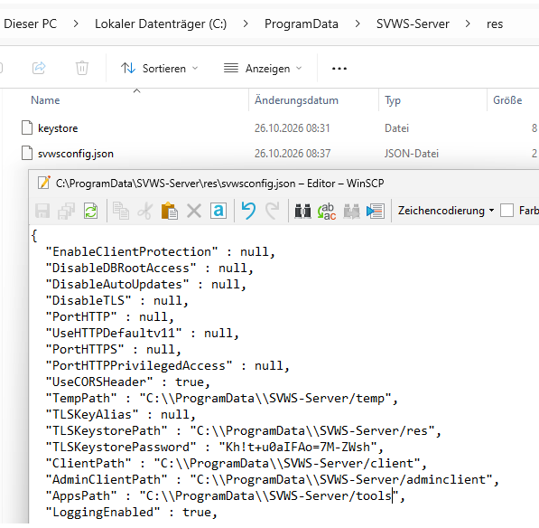
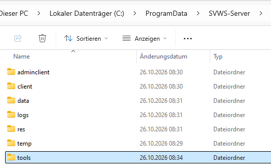
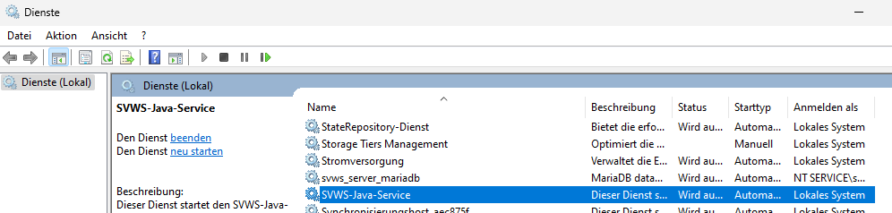

# SVWS-Tools beim SVWS-Server unter Windows

## Download-Link zur Datei **tools.zip**:

https://github.com/TheoRichter/SVWS-Tools/raw/refs/heads/main/downloads/tools.zip

## Anleitung

### Einbinden der SVWS-Tools Conference, Gradehub, Import, Laufbahnplanung und Prognos

In der **svwsconfig.json** folgendes Eintragen:

**AppsPath" : "C:\\ProgramData\\SVWS-Server/tools",**

in dem Verzeichniss **"C:\ProgramData\SVWS-Server"** *(wenn der SVWS-Server unter C: installiert ist!?)*

dort bitte die Datei **tools.zip** entpacken.

Den Dienst SVWS-Java-Service neu Starten.

Im Browser https://localhost/app/start eingeben und es müsste das Erscheinen.

