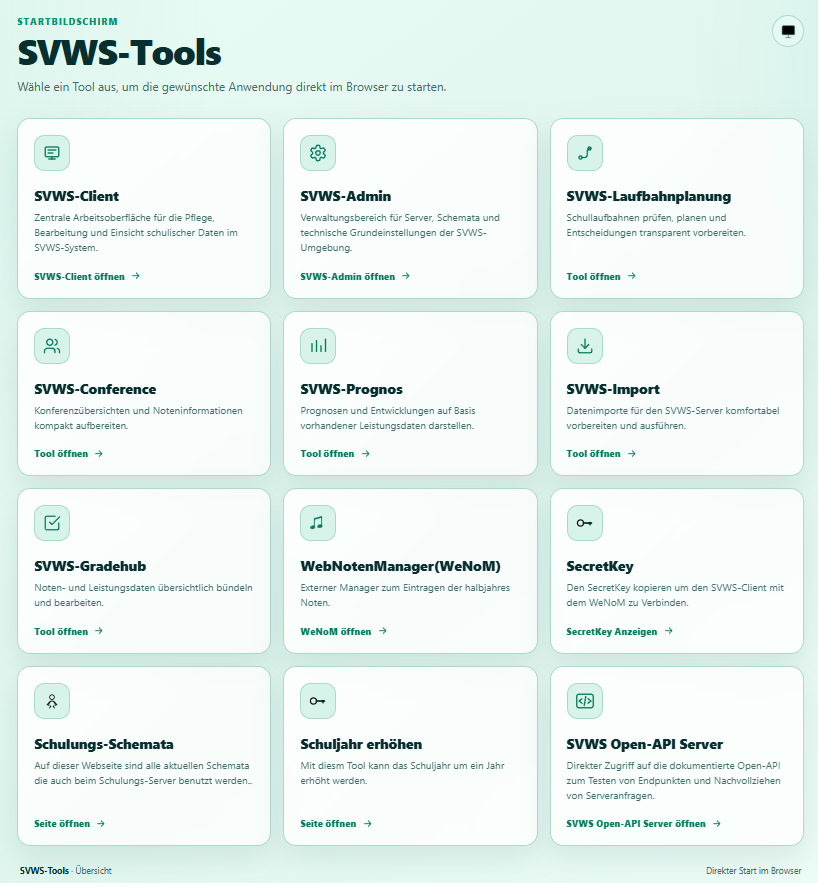

# SVWS-Tools beim SVWS-Server unter Windows

## Download-Link zur Datei **tools.zip**:

https://github.com/TheoRichter/SVWS-Tools/raw/refs/heads/main/downloads/tools.zip

### Einbinden der SVWS-Tools Conference, Gradehub, Import, Laufbahnplanung und Prognos

#### Anleitung

In der svwsconfig.json folgendes hinter

"AppsPath" Eintragen: "AppsPath" : "C:\\ProgramData\\SVWS-Server/tools",

in dem Verzeichniss "C:\ProgramData\SVWS-Server" *(wenn der SVWS-Server unter C: installiert ist!?)*

dort bitte die Datei **tools.zip** entpacken.

Dann den Dienst svws-java-service neu Starten.

Im Browser https://localhost/app/start eingeben und es müsste das Erscheinen.

