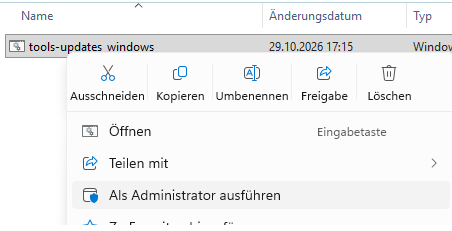

# Update von SVWS-Tools unter Windows

|SVWS|Release|Pfad|
|------:|:------|:------:|
|[Conference](https://github.com/SVWS-NRW/SVWS-Conference/releases)|1.0.0|C:\ProgramData\SVWS-Server\tools\conference|[
|[Gradehub](https://github.com/SVWS-NRW/SVWS-GradeHub/releases)|1.0.0|C:\ProgramData\SVWS-Server\tools\gadehub|
|[Import](https://github.com/SVWS-NRW/SVWS-Import/releases)|0.3.4|C:\ProgramData\SVWS-Server\tools\import|
|[Laufbahnplanung](https://github.com/SVWS-NRW/SVWS-Server/releases)|1.5.0|C:\ProgramData\SVWS-Server\tools\laufbahn|
|[Prognos](https://github.com/SVWS-NRW/SVWS-Prognos/releases)|0.5.0|C:\ProgramData\SVWS-Server\tools\prognos|

## Windows automatisches Tools-Update

 [Download von **Tools-Update_Windows.zip**](https://github.com/TheoRichter/SVWS-Tools/raw/refs/heads/main/downloads/tools-update_windows.zip)  

Die Datei **tools-update_windows.zip** entpacken und als Administrator starten. 

